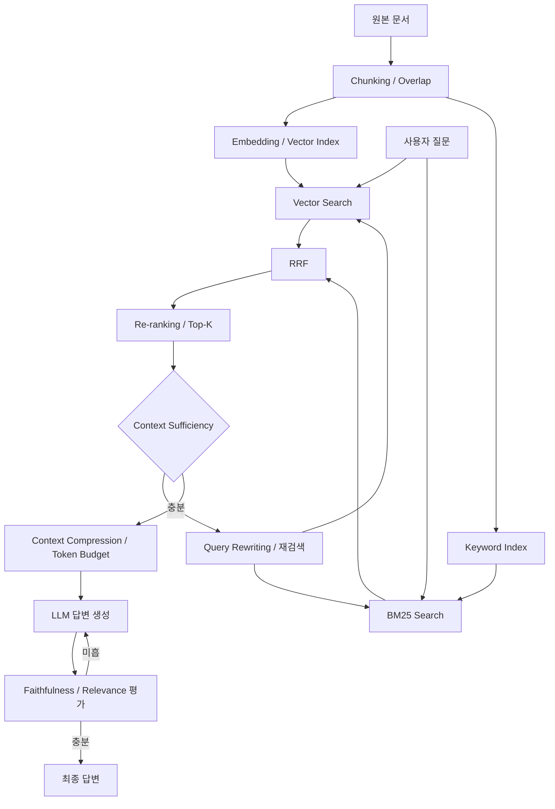

# LLM / RAG 학습 프로젝트

TypeScript와 Ollama를 기반으로 LLM 및 RAG(Retrieval-Augmented Generation)의 핵심 원리를 단계적으로 학습하는 프로젝트입니다. 기초 검색부터 고급 검색 전략, 답변 품질 평가까지 다룹니다.

## 기술 스택

| 구분 | 기술 |
|---|---|
| 언어 | TypeScript 5.9 |
| 실행 환경 | Node.js, tsx, npm |
| 로컬 모델 실행 | Ollama |
| LLM | qwen3:1.7b |
| Embedding | embeddinggemma |
| Tokenizer | @huggingface/tokenizers, Qwen3 tokenizer |
| 기타 의존성 | openai, dotenv |

## 프로젝트 구조

```text
LLM-RAG/
├── data/                  # 실습 데이터
├── docs/                  # 학습 정리 문서
├── src/                   # TypeScript 실습 코드
├── tokenizer.json         # Qwen3 tokenizer 데이터
├── tokenizer_config.json  # tokenizer 설정
├── package.json
├── package-lock.json
├── tsconfig.json
└── README.md
```

## 설치 및 실행

```bash
git clone https://github.com/TaeSeungRyu/LLM-RAG.git
cd LLM-RAG
npm ci
```

Ollama 설치 후 모델을 다운로드합니다.

```bash
ollama pull qwen3:1.7b
ollama pull embeddinggemma
ollama list
```

Ollama 서버가 실행 중이지 않다면 `ollama serve`를 실행합니다. API 호출 시 별도로 `ollama run`을 실행할 필요는 없습니다.

| API | 주소 |
|---|---|
| Chat | `http://localhost:11434/api/chat` |
| Embedding | `http://localhost:11434/api/embed` |

```bash
# 챗봇
npm run dev

# Embedding 실습
npx tsx src/embedding.ts
```

## 학습 진행 현황

아래는 학습 주제 기준의 정리이며, 모든 기법이 하나의 통합 애플리케이션으로 구현되었다는 의미는 아닙니다. 세부 학습 자료는 [docs](./docs), 실습 코드는 [src](./src)를 참고하세요.

| 범위 | 학습 주제 | 핵심 내용 |
|---|---|---|
| 1~8일 | LLM, Ollama, 대화 메모리, Embedding, 벡터 검색, RAG, Threshold/Top-K, Chunking/Overlap | 기본 RAG 구성 |
| 9~26일 | 검색 품질 개선 및 평가 | Re-ranking, Hit@K, MRR, Precision/Recall, F1, Correctness, Faithfulness, Relevance 등 |
| 27일 | Self-Corrective RAG | 답변 평가 후 재생성 |
| 28일 | Corrective RAG Search | 문맥 충분성 평가, 질문 재작성 및 재검색 |
| 29일 | Corrective RAG Merge | 검색 후보 병합 및 재평가 |
| 30일 | Context Budget | 참고자료 길이 제한 |
| 31일 | Context Compression | 핵심 문맥 추출 및 압축 |
| 32일 | Tokenizer / Token Budget | 실제 토큰 수 계산 |
| 33일 | Caching | 중복 계산 결과 재사용 |
| 34일 | Batch / Parallel Processing | 묶음 처리 및 동시 처리 |
| 35일 | Retry / Timeout / Fallback | 장애 대응 |
| 36일 | Hybrid Search | 의미 검색과 키워드 검색 결합 |
| 37일 | RRF | 검색 순위 기반 결과 통합 |

## RAG 아키텍처

학습한 검색 및 평가 기법을 종합한 개념적 파이프라인입니다. 각 단계는 요구사항에 따라 선택적으로 적용합니다.



재검색 및 재생성은 제한된 횟수 내에서 수행하는 것을 전제로 합니다.

## 핵심 기술 요약

| 기술 | 역할 |
|---|---|
| Embedding | 텍스트를 의미 벡터로 표현 |
| Cosine Similarity | 벡터 방향 유사도 계산 |
| Chunking / Overlap | 검색 단위 분할 및 경계 문맥 보존 |
| Top-K / Threshold | 검색 후보 개수와 최소 점수 제어 |
| Re-ranking | 질문과 문서의 관련성 재평가 |
| Corrective RAG | 검색 품질이 부족한 경우 검색 보완 |
| Context Budget / Compression | 참고자료 길이와 정보 밀도 관리 |
| BM25 | 단어 빈도, 희귀성, 문서 길이 기반 키워드 검색 |
| Hybrid Search | Vector Search와 Keyword Search 결합 |
| RRF | 서로 다른 검색 목록의 순위를 기반으로 통합 점수 계산 |

RRF는 각 검색 목록에서 문서의 순위에 따라 `1 / (k + rank)`를 계산하고 합산합니다. 원래 검색 점수의 척도가 달라도 통합할 수 있으며, 별도의 LLM 호출이 필요하지 않습니다.

## 평가 지표

| 지표 | 의미 |
|---|---|
| Hit@K | 상위 K개에 관련 문서가 포함되는지 |
| Precision@K | 상위 K개 중 관련 문서의 비율 |
| Recall@K | 전체 관련 문서 중 검색된 비율 |
| F1 | Precision과 Recall의 조화평균 |
| MRR | 첫 관련 문서의 역순위 평균 |
| Correctness | 답변의 사실적 정확성 |
| Faithfulness | 답변의 참고자료 근거 충실도 |
| Answer Relevance | 질문과 답변의 관련성 |
| Context Sufficiency | 참고자료만으로 답변 가능한지 |

## 향후 학습

- Multi-Query Retrieval
- HyDE
- Parent-Child Retrieval
- Self-Query Retrieval
- Query Routing
- Graph RAG

일반적인 시스템 최적화보다 RAG의 검색 품질, 문맥 구성 및 답변 정확도 개선에 집중합니다.
