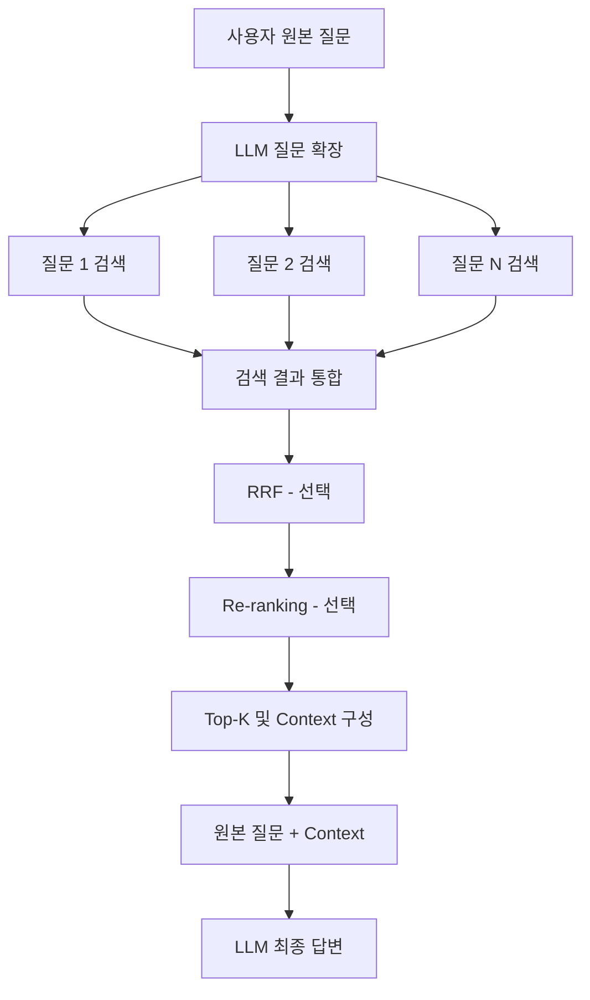

# Multi-Query Retrieval

## 1. 개념 및 목적

Multi-Query Retrieval은 하나의 사용자 질문을 여러 검색 질문으로 확장하고, 각각 검색하여 관련 문서의 누락을 줄이는 RAG 검색 전략이다. 주요 목적은 Recall(재현율) 개선이다.

- 일반적으로 LLM을 활용하여 N개의 검색 질문을 생성한다.
- 원본 질문도 검색에 포함하면 질문의 의도가 변형되는 위험을 줄일 수 있다.
- RRF는 필수가 아니라 선택 사항이다.
- 최종 답변은 확장된 질문이 아닌 원본 질문을 기준으로 생성한다.

## 2. 처리 흐름



RRF를 적용한다면 각 검색 결과의 원래 순위를 유지해야 한다. 중복 문서의 순위별 점수를 합산한 후 하나의 통합 결과로 정렬한다.

## 3. 검색 예시

원본 질문: ABC 회사의 복지제도는?

| 검색 질문 | 검색 결과 |
|---|---|
| ABC 회사의 복지제도는? | A, B |
| ABC 회사의 직원 복리후생은? | A, B |
| ABC 회사의 직원 지원 제도는? | B, C |
| ABC 회사의 근무 환경 혜택은? | A, D |

| 문서 | 내용 |
|---|---|
| A | 식대 지원 |
| B | 건강검진 지원 |
| C | 자녀 학자금 지원 |
| D | 유연근무제 |

관련 문서가 총 4개라면 기존 검색의 Recall은 50%, 병합된 Multi-Query 검색의 Recall은 100%이다. 이는 가상 예시이며 실제 성능을 보장하지 않는다.

## 4. TypeScript 실습 (외부 연동 없음)

```typescript
const question = "ABC 회사의 복지제도는?";

// LLM 질문 확장 결과를 하드코딩
const queries = [
  question,
  "ABC 회사의 직원 복리후생은?",
  "ABC 회사의 직원 지원 제도는?",
  "ABC 회사의 근무 환경 혜택은?",
];

const documents: Record<string, string> = {
  A: "매월 식대를 지급합니다.",
  B: "건강검진 비용을 지원합니다.",
  C: "자녀 학자금을 지원합니다.",
  D: "유연근무제를 운영합니다.",
};

// 각 질문의 검색 결과 (순위 순서 유지)
const searchResults: Record<string, string[]> = {
  [queries[0]]: ["A", "B"],
  [queries[1]]: ["A", "B"],
  [queries[2]]: ["B", "C"],
  [queries[3]]: ["A", "D"],
};

const results = queries.map(query => searchResults[query]);

// 기본 Multi-Query: 병합 및 중복 제거
const candidates = [...new Set(results.flat())];
console.log("검색 후보:", candidates);

// 선택 사항: RRF로 순위 통합
const scores = new Map<string, number>();
const k = 60;

for (const ids of results) {
  ids.forEach((id, index) => {
    const rank = index + 1;
    scores.set(id, (scores.get(id) ?? 0) + 1 / (k + rank));
  });
}

const ranked = [...scores.entries()].sort((a, b) => b[1] - a[1]);
console.table(ranked);

const topK = ranked.slice(0, 4);
const context = topK.map(([id]) => documents[id]).join("\n");
const prompt = `참고자료:\n${context}\n\n질문: ${question}\n참고자료를 기반으로 답변하세요.`;
console.log(prompt);
```

실제 개발에서는 하드코딩된 질문을 LLM 호출로, 검색 결과를 Embedding 및 Vector Search 등으로 교체한다. 위 코드는 최종 프롬프트까지만 구성하며 실제 답변 생성은 수행하지 않는다.

## 5. 기술 비교

| 기술 | 핵심 목적 |
|---|---|
| Multi-Query Retrieval | 검색 질문 다양화 |
| Hybrid Search | 검색 방식 다양화 (Vector Search + BM25 등) |
| RRF | 여러 검색 결과의 순위 통합 |
| Re-ranking | 원본 질문과 문서의 관련성 재평가 |
| Query Rewriting | 검색에 적합하도록 질문 재작성 |
| Top-K | 상위 K개 문서 선정 |

## 6. 적용 가능한 구조

1. Multi-Query → 병합 및 중복 제거 → Context
2. Multi-Query → RRF → Top-K → Context
3. Multi-Query → RRF → Re-ranking → Top-K → Context

검색 질문이 많아지면 비용과 지연시간이 증가하고 관련성이 낮은 문서가 포함될 수 있다. RRF와 Re-ranking은 필요에 따라 적용하고 평가 지표로 효과를 확인한다.

## 7. 면접 대비

**Q. Multi-Query Retrieval이란?**

하나의 사용자 질문을 여러 검색 질문으로 확장하고 각각의 검색 결과를 통합하여 관련 문서의 누락을 줄이는 RAG 검색 전략입니다. 필요에 따라 RRF와 Re-ranking을 적용하고 원본 질문과 최종 Context를 LLM에 전달합니다.

**핵심 암기:** Multi-Query는 질문을 다양화하고, Hybrid Search는 검색 방식을 다양화하며, RRF는 검색 결과의 순위를 통합한다.
