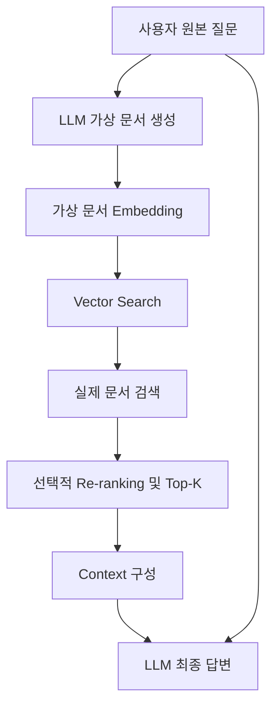

# RAG HyDE (Hypothetical Document Embeddings)

## 1. 개념 및 목적

HyDE(가상 문서 임베딩)는 사용자 질문에 대해 LLM으로 가상의 답변 또는 문서를 생성하고, 이를 Embedding하여 실제 관련 문서를 검색하는 RAG 전략이다.

- 짧은 질문과 설명문 형태의 실제 문서 사이의 표현 차이를 줄인다.
- 관련 도메인 용어를 활용하여 검색 품질을 개선할 수 있다.
- 가상 문서는 검색용이며 최종 답변의 근거가 아니다.

## 2. 처리 흐름



## 3. 예시

**원본 질문:** ABC 회사의 복지제도는?

**가상 문서 생성용 프롬프트:**

```text
다음 질문과 관련된 가상의 참고 문서를 생성하세요.
검색에 활용할 주요 용어를 포함하고 설명문 형태로 작성하세요.
질문: ABC 회사의 복지제도는?
```

**LLM의 가상 응답:** ABC 회사는 식대, 건강검진, 자녀 학자금, 유연근무제 등을 제공합니다.

이 가상 응답을 Embedding하여 실제 문서를 검색한다.

| 항목 | 가상 문서 | 실제 검색 문서 |
|---|---|---|
| 식대 | 30만 원 | 20만 원 |
| 건강검진 | 지원 | 지원 |
| 학자금 | 지원 | 지원 |
| 유연근무제 | 지원 | 확인되지 않음 |

최종 답변에서는 실제 문서에 따라 식대 20만 원을 안내하고, 유연근무제 지원 여부는 단정하지 않는다. 위 내용은 학습용 가상 예시다.

## 4. TypeScript 실습

`src/hyde.ts`

```typescript
interface Chunk {
  id: string;
  content: string;
}

const question = "ABC 회사의 복지제도는?";

// 1. LLM 가상 문서 생성 (Mock)
function generateHypotheticalDocument(question: string): string {
  return "ABC 회사는 식대, 건강검진, 자녀 학자금, 유연근무제 등을 제공합니다.";
}

// 2. Embedding (Mock)
function embedding(text: string): number[] {
  return [0.82, 0.41, 0.65];
}

// 3. Vector Search (Mock)
function vectorSearch(vector: number[]): Chunk[] {
  return [
    { id: "A", content: "매월 식대 20만 원을 지급합니다." },
    { id: "B", content: "건강검진 비용을 지원합니다." },
    { id: "C", content: "자녀 학자금을 지원합니다." },
  ];
}

const hypotheticalDoc = generateHypotheticalDocument(question);
const vector = embedding(hypotheticalDoc);
const results = vectorSearch(vector);

// 4. 실제 문서만 Context에 포함
const context = results.map(chunk => chunk.content).join("\n");

// 5. 원본 질문으로 최종 프롬프트 구성
const prompt = `
참고자료:
${context}

질문: ${question}
참고자료를 기반으로 답변하세요.
확인되지 않은 정보는 단정하지 마세요.
`;

console.log("가상 문서:", hypotheticalDoc);
console.log("검색 결과:", results);
console.log("최종 프롬프트:", prompt);
```

실제 LLM, Embedding, Vector DB 연동은 생략했다. 고정값을 사용하므로 검색 품질을 검증하는 코드는 아니다.

## 5. 핵심 로직 비교

```typescript
// 기존 검색
const vector = await embedding(question);

// HyDE (개념 코드)
const hypotheticalDoc = await generateHypotheticalDocument(question);
const hydeVector = await embedding(hypotheticalDoc);
```

기본 HyDE 구조에서는 가상 문서 생성과 최종 답변 생성에 각각 LLM을 한 번씩 호출한다. Embedding 모델 호출은 별도다.

## 6. 기존 기술과 비교

| 기술 | 핵심 역할 |
|---|---|
| Vector Search | 원본 질문과 유사한 문서 검색 |
| Query Rewriting | 검색에 적합한 질문으로 재작성 |
| Multi-Query Retrieval | 여러 검색 질문으로 확장 |
| HyDE | 가상 문서를 생성하고 임베딩하여 검색 |
| Hybrid Search | 여러 검색 방식 활용 |
| RRF | 여러 검색 결과의 순위 통합 |
| Re-ranking | 원본 질문과 문서의 관련성 재평가 |

Multi-Query와 HyDE는 함께 사용할 수도 있다. RRF와 Re-ranking은 선택 사항이다.

## 7. 장단점

| 장점 | 단점 |
|---|---|
| 추상적인 질문 구체화 | 추가 LLM 호출 및 지연 |
| 도메인 용어 활용 | 잘못된 가상 문서로 검색 방향 왜곡 가능 |
| 검색 품질 개선 가능 | 항상 성능이 향상되지는 않음 |

## 8. 면접 대비

**Q. HyDE란 무엇인가요?**

HyDE는 사용자 질문에 대해 LLM으로 가상의 문서를 생성하고, 해당 문서를 Embedding하여 실제 관련 문서를 검색하는 RAG 전략입니다. 질문과 실제 문서 사이의 표현 차이를 줄이는 것이 목적이며, 가상 문서는 검색용으로만 활용합니다.

**핵심 암기:** Multi-Query는 질문을 여러 개로 확장하고, HyDE는 질문을 가상의 답변으로 변환한다. 최종 답변은 원본 질문과 실제 검색 문서를 기반으로 생성한다.

## 다음 학습

40일 차 — Parent-Child Retrieval (부모-자식 문서 검색)
