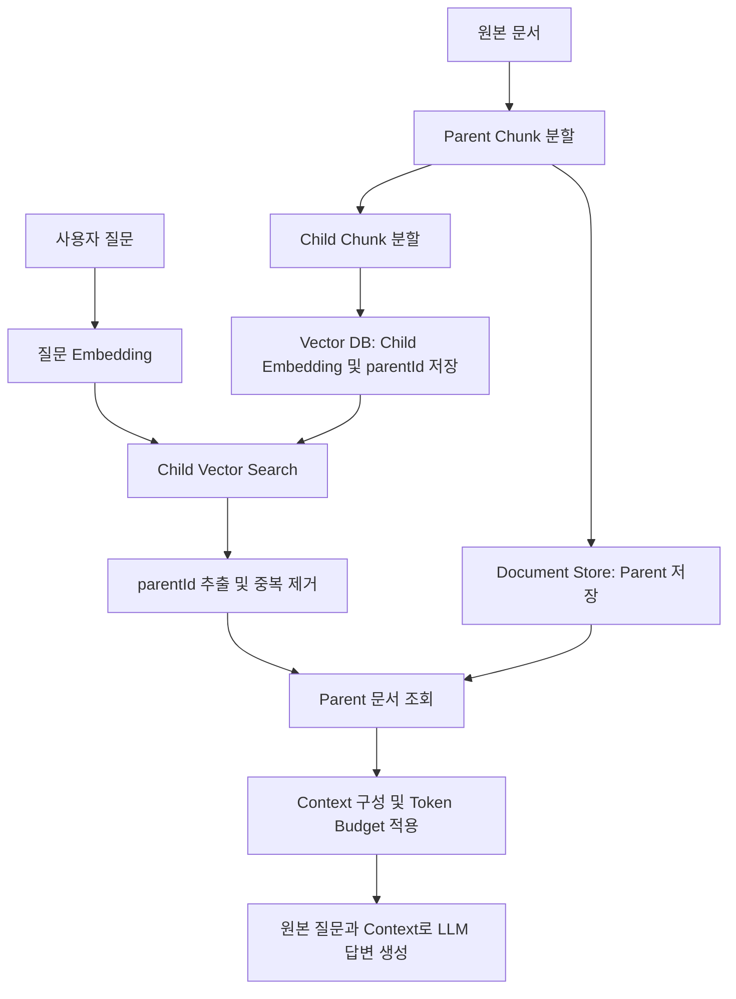

# Parent-Child Retrieval

## 1. 개념 및 목적

Parent-Child Retrieval은 작은 Child Chunk로 검색하고, 해당 Child가 속한 큰 Parent Chunk를 참고자료로 반환하는 RAG 검색 전략이다.

- Child: 구체적인 내용 검색에 유리한 작은 단위
- Parent: 예외 조건과 주변 문맥을 보존하는 큰 단위
- parentId: Child와 Parent를 연결하는 식별자

**검색 단위와 LLM에 전달하는 참고자료 단위를 분리하는 것이 핵심이다.**

## 2. 기존 RAG와 비교

| 구분 | 기존 RAG | Parent-Child Retrieval |
|---|---|---|
| 검색 대상 | Chunk | Child Chunk |
| 참고자료 | 검색된 Chunk | 해당 Parent Chunk |
| 문맥 보존 | 작은 Chunk에서는 제한적 | 주변 문맥 확보 가능 |
| 추가 LLM 호출 | 불필요 | 불필요 |

## 3. 예시

Parent P1: 식대 지원 규정

| Child ID | Parent ID | 내용 |
|---|---|---|
| C1 | P1 | 정규직 직원에게 매월 식대 20만 원 지급 |
| C2 | P1 | 수습 기간에는 10만 원 지급 |
| C3 | P1 | 계약직은 별도 계약 조건 적용 |

질문: ABC 회사의 식대는 얼마인가요?

기존 검색에서 C1만 검색되면 수습 기간 및 계약직 조건이 누락될 수 있다. Parent-Child Retrieval에서는 C1의 parentId를 통해 P1 전체를 조회하므로 예외 조건까지 참고자료에 포함할 수 있다.

## 4. 전체 처리 흐름



Parent와 Child는 반드시 서로 다른 물리적 DB에 저장할 필요는 없다.

## 5. TypeScript 실습

실제 LLM, Embedding, Vector DB 연동 없이 고정된 검색 결과로 처리 흐름을 확인한다.

```typescript
interface Parent {
  id: string;
  content: string;
}

interface Child {
  id: string;
  parentId: string;
  content: string;
}

const parents: Parent[] = [
  {
    id: "P1",
    content: "정규직 식대 20만 원 지급. 수습 기간 10만 원 지급. 계약직은 별도 계약 조건 적용.",
  },
  {
    id: "P2",
    content: "직원 건강검진 비용 지원. 배우자 건강검진 비용 일부 지원.",
  },
];

const children: Child[] = [
  { id: "C1", parentId: "P1", content: "정규직 식대 20만 원 지급" },
  { id: "C2", parentId: "P1", content: "수습 기간 식대 10만 원 지급" },
  { id: "C3", parentId: "P1", content: "계약직은 별도 계약 조건 적용" },
  { id: "C4", parentId: "P2", content: "직원 건강검진 비용 지원" },
  { id: "C5", parentId: "P2", content: "배우자 건강검진 비용 일부 지원" },
];

const question = "ABC 회사의 식대는 얼마인가요?";

// 1. Child Vector Search 결과 (Mock)
const searchResults = [children[0], children[1]];

// 2. Parent ID 추출 및 중복 제거
const parentIds = [...new Set(searchResults.map(child => child.parentId))];

// 3. 검색 순서를 유지하며 Parent 조회
const parentMap = new Map(parents.map(parent => [parent.id, parent]));
const results = parentIds
  .map(id => parentMap.get(id))
  .filter((parent): parent is Parent => parent !== undefined);

// 4. Context 구성
const context = results.map(parent => parent.content).join("\n\n");

// 5. 최종 LLM 프롬프트
const prompt = `참고자료:\n${context}\n\n질문:\n${question}\n\n참고자료를 기반으로 답변하세요.`;

console.log("Parent IDs:", parentIds);
console.log(prompt);
```

### 예상 결과

```text
Parent IDs: [ 'P1' ]
참고자료:
정규직 식대 20만 원 지급. 수습 기간 10만 원 지급. 계약직은 별도 계약 조건 적용.

질문:
ABC 회사의 식대는 얼마인가요?

참고자료를 기반으로 답변하세요.
```

C1과 C2가 동일한 P1에 속하므로 Parent는 한 번만 반환한다. 실제 검색이나 답변 생성 성능을 검증하는 코드는 아니다.

## 6. Chunk 크기 설정

| 구분 | 예시 | 목적 |
|---|---:|---|
| Parent | 1,000 Tokens | 문맥 보존 |
| Child | 200 Tokens | 세부 내용 검색 |
| Child Overlap | 40 Tokens | 경계 정보 손실 완화 |

고정된 권장값은 아니며 문서 구조와 평가 결과에 따라 조정한다. Parent가 너무 크면 불필요한 정보와 토큰 사용량이 증가하므로 Token Budget, Context Compression 등을 고려한다.

## 7. 장단점

| 장점 | 단점 |
|---|---|
| 작은 Chunk의 검색상 장점 활용 | Parent-Child 관계 관리 필요 |
| 예외 조건 및 주변 문맥 확보 | Context 토큰 증가 가능 |
| 정보 누락 감소 가능 | 불필요한 주변 정보 포함 가능 |
| 별도의 LLM 호출 불필요 | Parent 조회 과정 추가 |

## 8. 관련 기술 비교

| 기술 | 핵심 |
|---|---|
| Chunking | 문서 분할 |
| Overlap | 분할 경계의 문맥 보존 |
| Multi-Query Retrieval | 검색 질문 다양화 |
| HyDE | 가상 문서로 검색 |
| RRF | 검색 결과 순위 통합 |
| Parent-Child Retrieval | 작은 문서로 검색하고 큰 문서 반환 |
| Context Compression | 참고자료의 불필요한 정보 압축 |

## 9. 면접 대비

**Q. Parent-Child Retrieval이란?**

작은 Child Chunk를 검색하고 parentId를 통해 더 큰 Parent 문서를 조회하여 LLM의 참고자료로 활용하는 RAG 전략입니다. 검색 정확도와 문맥 보존을 함께 고려하는 것이 목적입니다.

**Q. 동일한 Parent에 속한 Child가 여러 개 검색되면?**

parentId 기준으로 중복 제거하여 동일한 Parent를 한 번만 가져옵니다.

**Q. Parent도 반드시 Embedding해야 하나요?**

아닙니다. 기본 구조에서는 Child만 Embedding하고 Parent는 원문 조회용으로 저장해도 됩니다.

## 10. 핵심 요약

- 검색: Child Chunk
- 참고자료: Parent Chunk
- 연결: parentId
- 목적: 검색 정확도와 문맥 보존의 균형
- 다음 학습: 41일 차 Self-Query Retrieval (검색 질문과 Metadata 필터 분리)
