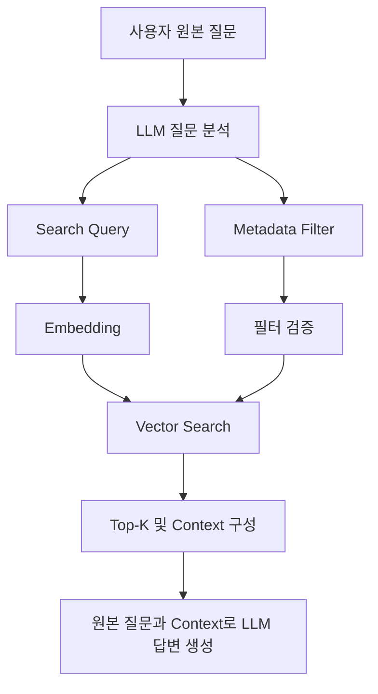

# Self-Query Retrieval

## 1. 핵심 개념

사용자의 자연어 질문을 LLM으로 분석하여 **의미 기반 검색 질문(Search Query)**과 **정확한 검색 조건(Metadata Filter)**으로 분리하는 RAG 검색 전략이다.

쉽게 말하면 Vector Search에 사용할 SQL의 WHERE 조건을 LLM이 생성하는 기술이다.

## 2. 예시

원본 질문: 2026년 인사팀의 복지제도를 알려줘.

```json
{
  "query": "복지제도",
  "filters": { "year": 2026, "department": "인사팀" }
}
```

| ID | 내용 | 연도 | 부서 | 유사도 | 필터 통과 |
|---|---|---:|---|---:|---|
| A | 식대 지원 | 2024 | 인사팀 | 0.95 | X |
| B | 식대 지원 | 2025 | 인사팀 | 0.92 | X |
| C | 식대 20만 원 지원 | 2026 | 인사팀 | 0.90 | O |
| D | 서버 구축 비용 | 2026 | 개발팀 | 0.50 | X |
| E | 건강검진 지원 | 2026 | 인사팀 | 0.85 | O |

유사도가 가장 높은 A도 필터 조건을 충족하지 않으면 제외한다. 최종 검색 결과는 C, E이다.

## 3. 처리 흐름



## 4. LLM 프롬프트 예시

```text
사용자 질문을 검색 질문과 Metadata Filter로 분리하세요.
사용 가능한 필드: year(number), department(string).
명시된 조건만 추출하고 조건이 없다면 filters를 빈 객체로 반환하세요.
존재하지 않는 필드를 생성하지 마세요.
JSON 형식으로 반환하세요.
질문: 2026년 인사팀의 복지제도를 알려줘.
```

## 5. TypeScript 실습

실제 LLM, Embedding, Vector DB 연동 없이 고정값으로 처리 흐름을 확인한다.

```typescript
interface Metadata {
  year: number;
  department: string;
}
interface Chunk {
  id: string;
  content: string;
  metadata: Metadata;
  score: number;
}

const documents: Chunk[] = [
  { id: 'A', content: '2024년 식대 지원', metadata: { year: 2024, department: '인사팀' }, score: 0.95 },
  { id: 'B', content: '2025년 식대 지원', metadata: { year: 2025, department: '인사팀' }, score: 0.92 },
  { id: 'C', content: '2026년 식대 20만 원 지원', metadata: { year: 2026, department: '인사팀' }, score: 0.90 },
  { id: 'D', content: '서버 구축 비용 지원', metadata: { year: 2026, department: '개발팀' }, score: 0.50 },
  { id: 'E', content: '2026년 건강검진 지원', metadata: { year: 2026, department: '인사팀' }, score: 0.85 },
];

const question = '2026년 인사팀의 복지제도를 알려줘.';

// LLM 분석 결과 (Mock)
const selfQuery: { query: string; filters: Partial<Metadata> } = {
  query: '복지제도',
  filters: { year: 2026, department: '인사팀' },
};

// Metadata Filtering: 조건이 없는 필드는 검사하지 않는다.
const filtered = documents.filter(doc =>
  (selfQuery.filters.year === undefined || doc.metadata.year === selfQuery.filters.year) &&
  (selfQuery.filters.department === undefined || doc.metadata.department === selfQuery.filters.department)
);

// Vector Search 점수는 고정값으로 대체
const topK = filtered.sort((a, b) => b.score - a.score).slice(0, 3);
const context = topK.map(doc => doc.content).join('\n');
const prompt = `참고자료:\n${context}\n\n질문: ${question}\n참고자료를 기반으로 답변하세요.`;
console.table(topK);
console.log(prompt);
```

예상 결과: C, E. 실제 구현에서는 selfQuery.query를 Embedding하고 검증된 필터를 Vector DB 검색에 전달한다.

## 6. SQL과 비교

```sql
-- 개념 예시: vector_distance는 가상의 함수
SELECT * FROM documents
WHERE year = 2026 AND department = '인사팀'
ORDER BY vector_distance(embedding, query_vector)
LIMIT 3;
```

## 7. 주의사항 및 장단점

- 문서 저장 시 연도, 부서, 카테고리 등 Metadata를 함께 저장해야 한다.
- LLM이 생성한 필드명, 타입, 연산자, 값은 실행 전에 검증한다.
- 접근 권한 필터는 LLM에 맡기지 않고 서버에서 강제한다.
- 조건 기반 검색의 정확도를 높일 수 있지만, 잘못된 필터는 관련 문서를 누락시킬 수 있다.
- 추가 LLM 호출 비용이 발생한다.

## 8. 기존 기술 비교

| 기술 | 핵심 전략 |
|---|---|
| Query Rewriting | 검색 질문 재작성 |
| Multi-Query Retrieval | 검색 질문 여러 개 생성 |
| HyDE | 가상 답변을 Embedding하여 검색 |
| Parent-Child Retrieval | 작은 Chunk로 검색하고 큰 Chunk 반환 |
| Self-Query Retrieval | 검색 질문과 Metadata Filter 분리 |
| RRF | 여러 검색 결과의 순위 통합 |
| Re-ranking | 원본 질문 기준 관련성 재평가 |

## 9. 면접 대비

**Self-Query Retrieval이란?** 사용자 자연어 질문을 LLM으로 분석하여 의미 기반 검색 질문과 구조화된 Metadata 필터로 분리하고, 이를 결합하여 관련 문서를 검색하는 RAG 전략이다.

**핵심 암기:** Vector Search에 사용할 WHERE 조건을 LLM이 생성한다.

다음 학습: 42일 차 — Query Routing.
